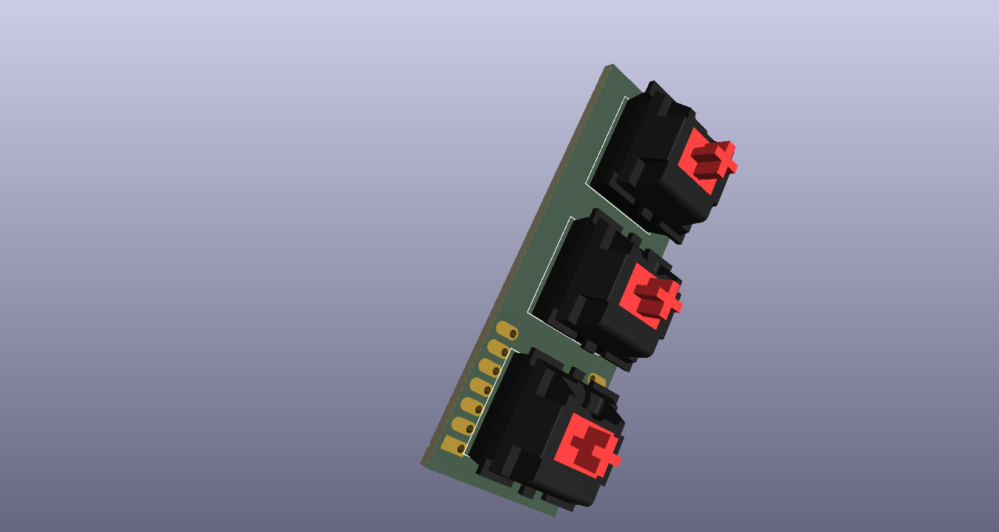
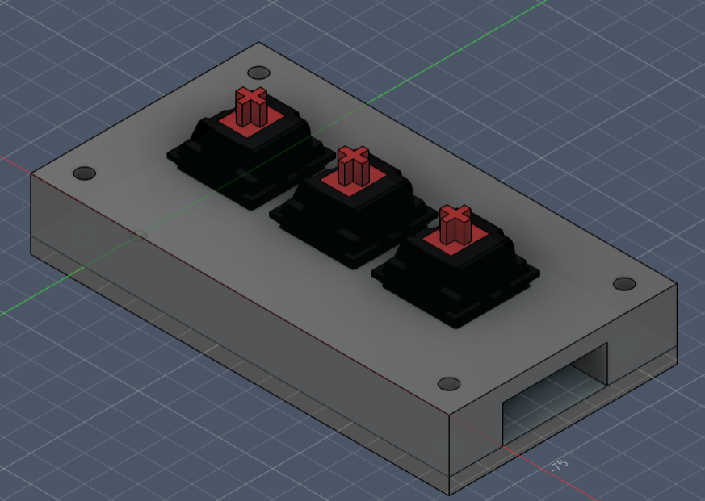
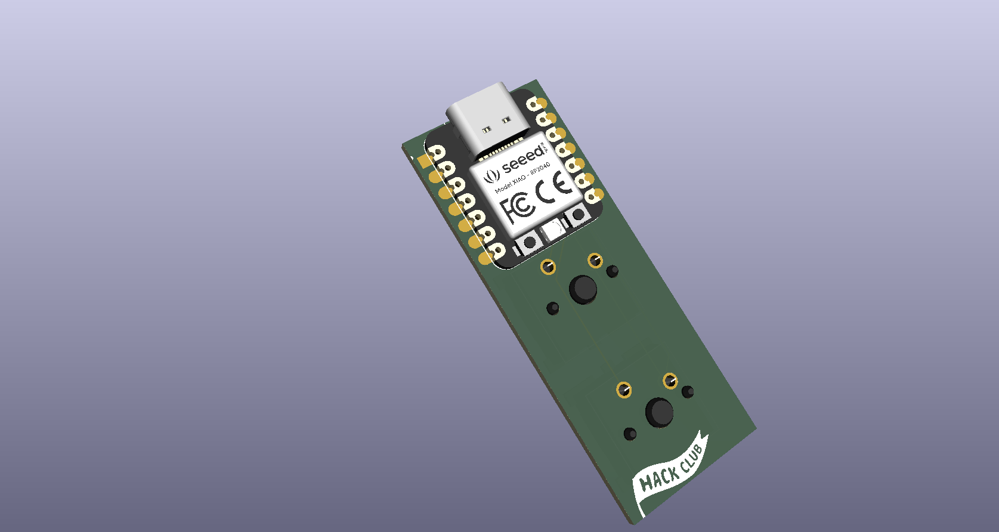
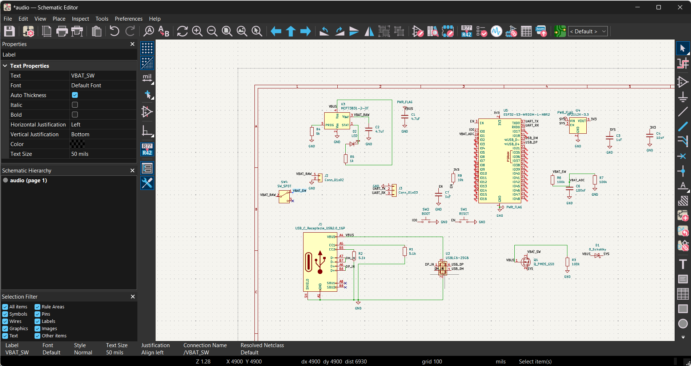
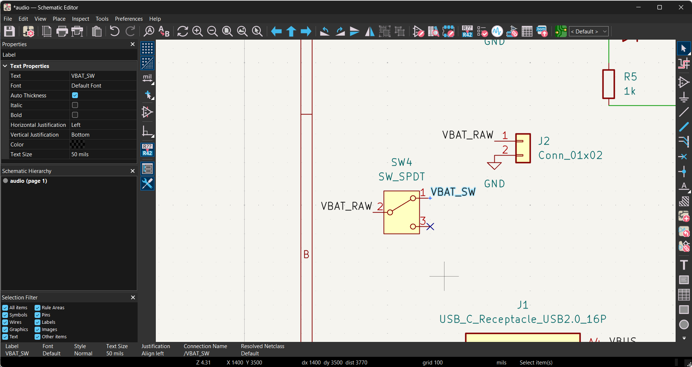
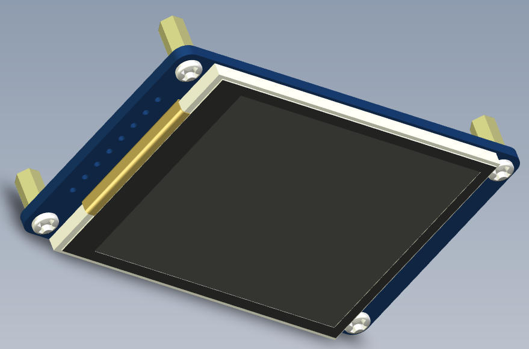
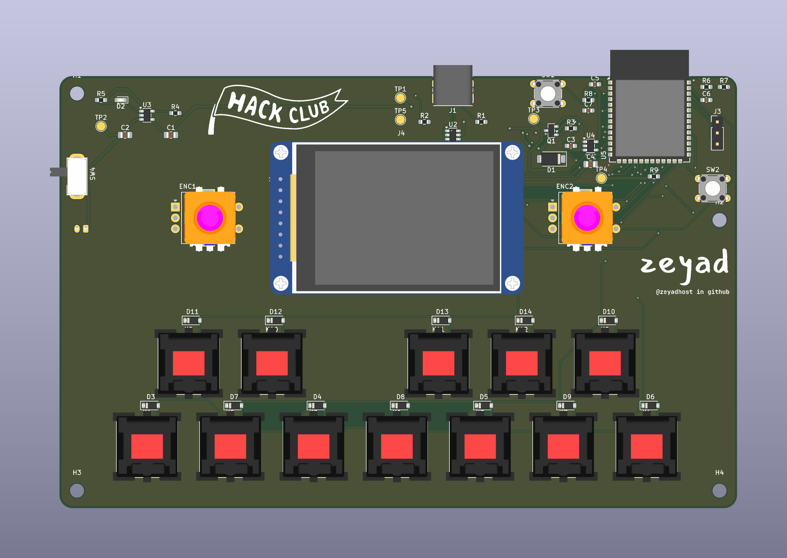
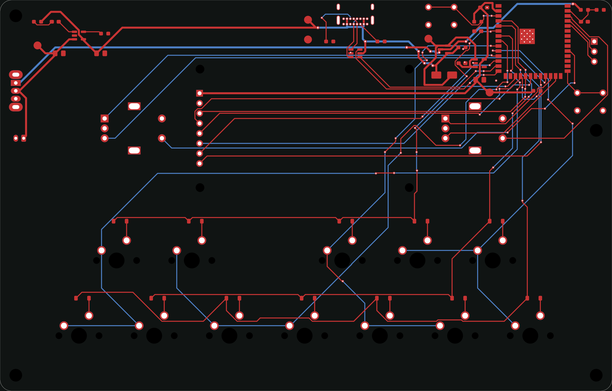
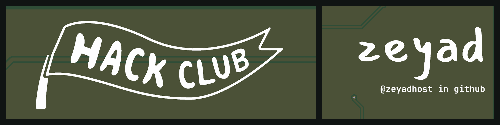

# Created the PCB and the case

i created the pcb following the hackpad tutorial (outside lapse), it took me a while to get used and accustomed to the UI of kicad and fusion 360. i also made the case in fusion 360. until now i havent done any unique changes to make it a music/midi player but i will get working on that soon! i had an issue with extrusion when i had to extude the plate (after importing the dxf) but i got it working when i watched a youtube video explaining how to use extrude FULLY

**Total time spent: 1 hour**

# Wrote firmware and fixed case alignment

hi everyone! this is the last journal related to hackpad, as for the next journals i will be working on my own to make this "verispeed" more than its screaming "macropad". i wrote QMK firmware for my 3-key macropad. i also found 3d models for the cherry mx switches and the seeed studio xiao rp2040 which helped me in measuring how it'll look like when i buy the hardware. i had a lot of time adjusting the wiggle room for the switches and adjusting the usb cutout. but in the end, it turned out good! (i added wiggle room because i didnt know how to add pillars to hold the pcb from inside so i just added wiggleroom and pray for the best)

**Total time spent: 2.5 hours**

# Drew power schematic

hi everyone! this is the first journal of me starting with my NEW and UNIQUE changes for the hackpad (that probably wont even make it look like a hackpad anymore because i deleted everything). i asked my father today about how engineers go from "yo i wanna make x" to somehow getting the EXACT module names and know how to connect them he just told me they search, i didnt really understand so unfortunately i opened claude code and asked it to explain to me, what modules to find, and how to connect them. although claude gave me how to connect them, the ACTUAL things i learnt were the terms (schottky diode) and how to use kicad, like i just found out today that labeling wires are SHORTCUTS INSTEAD OF DRAWING A WIRE, like THATS THE MOST BIZARRE THING IVE EVER HEARD??? like I THOUGHT LABELS ARE LIKE COMMENTS IN CODING (but turns out that comments can run code now /j). i was really happy with todays process because i felt like an engineer (yes.) and im one step closer to shipping! as to what i did today, i drew the power block (and it passes ERC!). i added USB-C with a protection chip, a battery charger (with a led ofc) and a path so that i can use both usb or battery. here are some images while working:

i was also searching for the lcd screen i was going to use and i found this:

see you guys next time!

**Total time spent: 2.5 hours**

# Made the PCB and learnt about vias

hi everyone! this is the journal where i finally made the PCB for verispeed (the new one, with the esp32, the screen, two knobs and 12 keys laid out like a piano). i drew every single wire by hand in kicad and it was VERY complex, like 12 keys, 12 diodes and SO many wires that all have to reach the right place without touching each other. the biggest thing i learnt was how to use a VIA, and its basically a BURROW for the wire (yes, like where a rabbit lives). the wire goes down into a hole on one side of the board, goes under everything else, and comes back out on the other side, so the lines dont overlap together. after the wires i added the ground fill, rounded the corners, made the screw holes and put the hack club flag, my signature and my github name on the silkscreen (the white print on the board). at the end i ran the checks and got ZERO errors, and i pushed everything to github. it was very complex but i felt really happy at the end, im so happy with the result! next time i will work on the firmware, so i will only use hackatime from now on. here are some images of the result:

i also put the hack club flag and my signature on the silkscreen, here is how they look up close:

see you guys next time!

**Total time spent: 3.5 hours**
