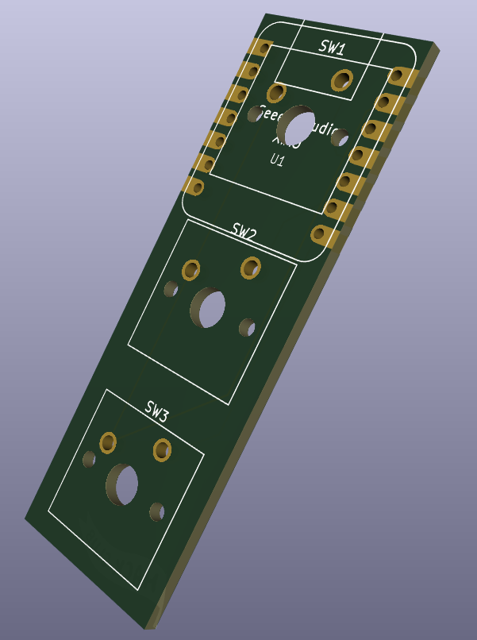
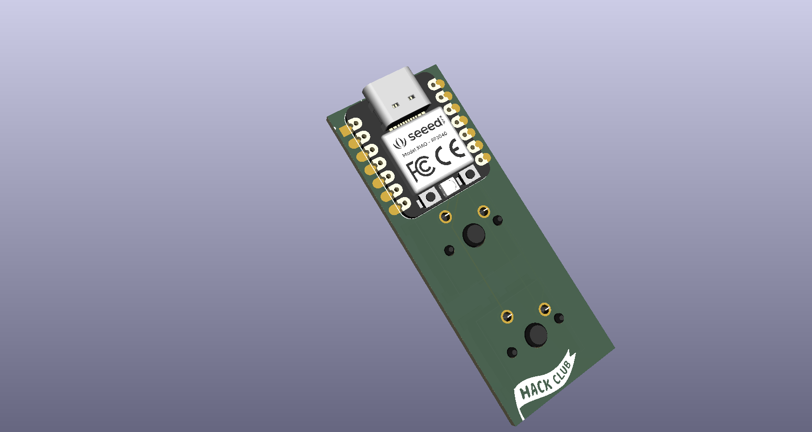

# Created the PCB and the case

i created the pcb following the hackpad tutorial (outside lapse), it took me a while to get used and accustomed to the UI of kicad and fusion 360. i also made the case in fusion 360. until now i havent done any unique changes to make it a music/midi player but i will get working on that soon! i had an issue with extrusion when i had to extude the plate (after importing the dxf) but i got it working when i watched a youtube video explaining how to use extrude FULLY

**Total time spent: 1 hour**

# 10/17/2026: Wrote firmware and fixed case alignment

hi everyone! this is the last journal related to hackpad, as for the next journals i will be working on my own to make this "verispeed" more than its screaming "macpad". i wrote QMK firmware for my 3-key macropad. i also found 3d models for the cherry mx switches and the seeed studio xiao rp2040 which helped me in measuring how it'll look like when i buy the hardware. i had a lot of time adjusting the wiggle room for the switches and adjusting the usb cutout. but in the end, it turned out good! (i added wiggle room because i didnt know how to add pillars to hold the pcb from inside so i just added wiggleroom and pray for the best)

**Total time spent: 2.5 hours**
