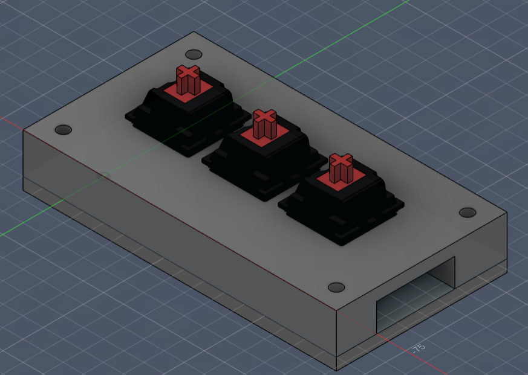
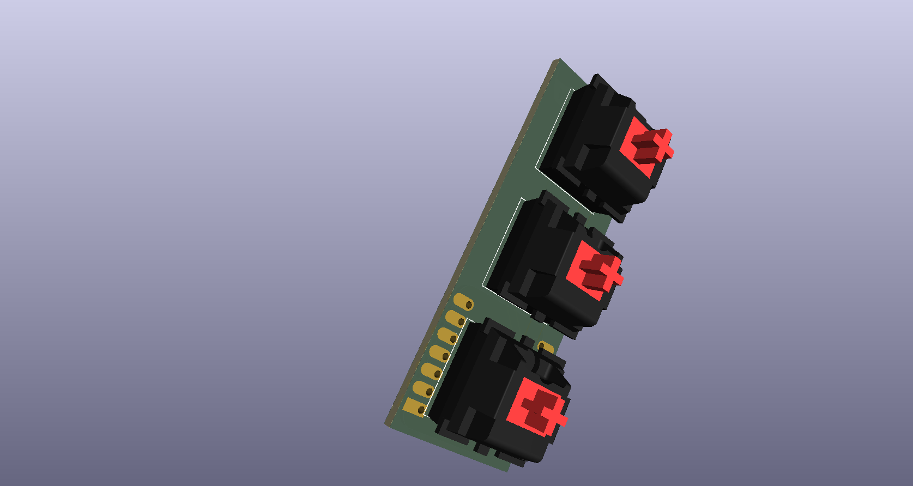

# Verispeed

A 3-key macropad built around the Seeed Studio XIAO RP2040. The project
includes the KiCad PCB design, the Fusion 360 case, and the QMK firmware.

## Overview

| Feature | Detail |
|---|---|
| **MCU** | Seeed Studio XIAO RP2040 |
| **Keys** | 3 (MX-style switches) |
| **Firmware** | QMK (RP2040) |
| **Case** | 3D printed (Fusion 360) |

## Images

### Case (Fusion 360)



### PCB — front



### PCB — back


## Repository layout

```
verispeed/
├── pcb/                          # KiCad project
│   ├── audio.kicad_pro
│   ├── audio.kicad_sch
│   ├── audio.kicad_pcb
│   ├── audio.step                # 3D export (PCB + switches + XIAO)
│   └── fp-lib-table              # points at ../libraries/footprints.pretty
├── case/
│   ├── verispeed_case.f3d        # final case
│   └── verispeed_pcb_model.f3d   # PCB + switches + XIAO (the case derives this)
├── firmware/
│   └── QMK/                      # QMK keyboard definition
│       ├── keyboard.json
│       ├── readme.md
│       └── keymaps/default/keymap.c
├── libraries/
│   ├── symbols/
│   │   ├── XIAO_RP2040.kicad_sym
│   │   └── SK6812MINI-E.kicad_sym
│   ├── footprints.pretty/
│   │   ├── XIAO-Generic-Hybrid-14P-2.54-21X17.8MM.kicad_mod
│   │   ├── SK6812MINI-E_fixed.kicad_mod
│   │   └── hackclub-logo.kicad_mod
│   └── 3dmodels/                 # STEP models used by the PCB
│       ├── SW_Cherry_MX_1.00u_PCB.step
│       └── XIAO-Generic-Hybrid-14P-2.54-21X17.8MM.step
└── images/
```

The Cherry MX switch 3D model comes from
[ConstantinoSchillebeeckx/cherry-mx-switch](https://github.com/ConstantinoSchillebeeckx/cherry-mx-switch)
(MIT license).

## Bill of Materials

| Qty | Part | Notes |
|-----|------|-------|
| 1 | Seeed Studio XIAO RP2040 | Controller |
| 3 | MX-compatible switches | PCB mount, soldered |
| 3 | Keycaps | MX stem |
| 1 | PCB | See `pcb/` |
| 1 | 3D-printed case | See `case/` |

## Getting started

### PCB

Open `pcb/audio.kicad_pro` in KiCad 8/9. Footprints resolve via
`${KIPRJMOD}/../libraries/footprints.pretty`, and the 3D models via
`${KIPRJMOD}/../libraries/3dmodels`, so keep the `pcb/` and `libraries/`
folders side by side.

To export the 3D model:

```bash
kicad-cli pcb export step --subst-models --drill-origin \
  --min-distance=0.001mm -f -o audio.step audio.kicad_pcb
```

### Case

Open `case/verispeed_case.f3d` in Fusion 360. The case derives the PCB
assembly from `case/verispeed_pcb_model.f3d` (Insert Derive). If the link
does not resolve on your machine, insert `verispeed_pcb_model.f3d` into the
case manually.

### Firmware

The QMK keyboard definition is in `firmware/QMK/`. Copy it into your QMK tree,
then build:

```bash
cp -r firmware/QMK ~/qmk_firmware/keyboards/verispeed
qmk compile -kb verispeed -km default
qmk flash   -kb verispeed -km default
```

To flash the XIAO: double-tap **RESET** (it mounts as `RPI-RP2`), then drag
`verispeed_default.uf2` onto that drive.

The keys are wired as **direct pins** (no diodes):

| Key | XIAO pin | QMK pin |
|-----|----------|---------|
| SW1 | D10 | `GP3` |
| SW2 | D9 | `GP4` |
| SW3 | D8 | `GP2` |

Default keymap: **Copy**, **Paste**, **Cut**.

## Credits

- Cherry MX 3D model: [ConstantinoSchillebeeckx/cherry-mx-switch](https://github.com/ConstantinoSchillebeeckx/cherry-mx-switch) (MIT)
- XIAO RP2040 3D model: vendor model
- Case and PCB designed by Zeyad Bekhet

## License

Released under the [MIT License](LICENSE).
