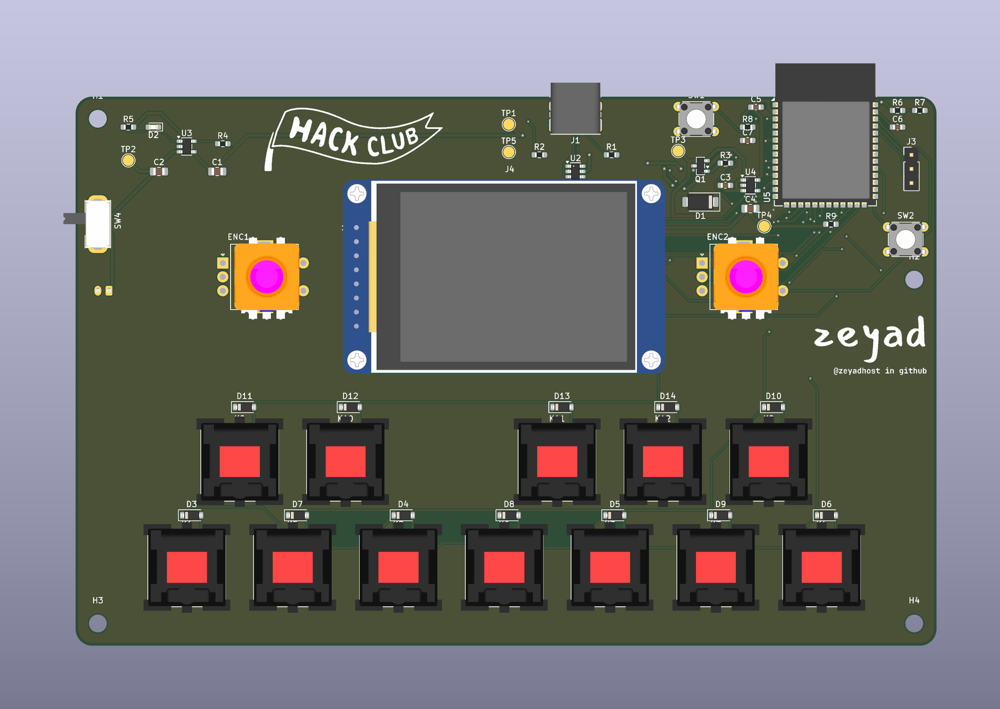
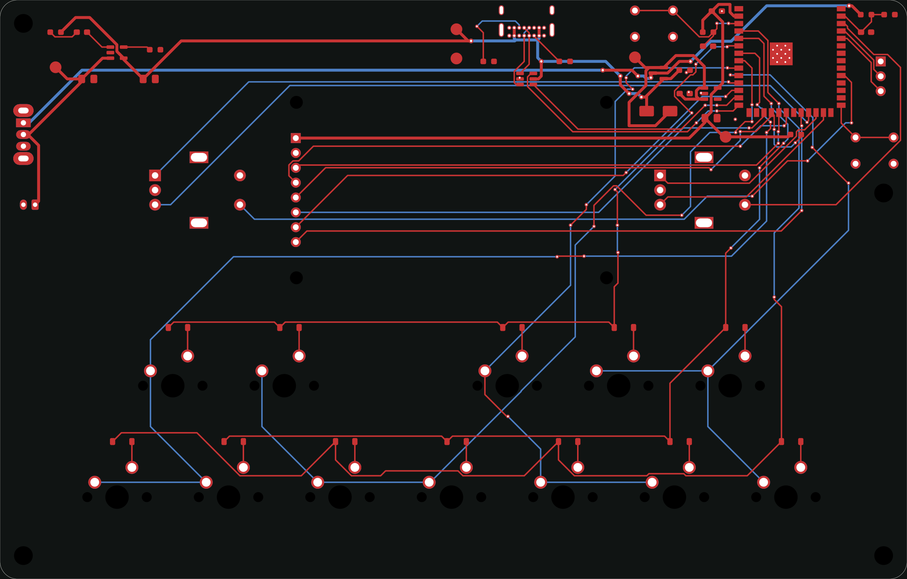

# Verispeed

A MIDI controller with 12 keys, 2 knobs and a screen. It works with music programs on a laptop.



Verispeed is one circuit board (PCB). It has no case. The 12 keys have the layout of one piano octave: 7 white keys and 5 black keys. The screen is in the center. There is one knob on each side of the screen.

The board has no speaker, so it does not make sound. It is a MIDI device. Connect it to a laptop with a USB-C cable. A music program on the laptop makes the sound. The program can be a DAW (digital audio workstation) or a software synthesizer.

The board also has Bluetooth LE. You can use it with a phone or a tablet.

Status: The design is finished and has no errors. The board is not built yet. The firmware is not written yet.

## Features

- 12 keys (MX-style switches), with 1 diode for each key
- 2 rotary encoders with a push button
- 2 inch color screen, 240 x 320 pixels
- ESP32-S3 module with USB and Bluetooth LE (8 MB flash, 2 MB PSRAM)
- Power from USB-C or from a 1-cell LiPo battery
- Battery charger on the board (200 mA)
- BOOT button, RESET button, serial header and 5 test points
- Board size 155 mm x 99 mm, 2 layers, 4 holes for M3 screws

## How it works

- Power: USB-C gives 5 V. A diode (D1) sends the 5 V to the system rail (SYS). The regulator U4 makes 3.3 V from SYS.
- Power source: When USB is connected, the P-MOSFET Q1 disconnects the battery. When USB is not connected, Q1 connects the battery.
- Battery: The charger U3 charges the battery at 200 mA. The red LED D2 is on while the battery charges. The slide switch SW4 disconnects the battery from the board. The charger still works when SW4 is off.
- Battery level: R6 and R7 divide the battery voltage by 2. GPIO1 reads the result. Multiply the value by 2 to get the battery voltage.
- USB: U2 protects the USB data lines from static electricity. R1 and R2 tell a USB-C power source to give 5 V. The ESP32-S3 has native USB, so it can be a USB-MIDI device with no extra chip.
- Keys: The 12 keys are in a matrix of 3 rows and 4 columns. The diode of each key points from the column to the row.
- Screen: The screen connects to the header J4 and uses the default SPI pins. GPIO14 controls the backlight.
- Firmware: To load new firmware, hold the BOOT button (SW2) and push the RESET button (SW1). The ESP32-S3 then waits for new firmware on USB. The header J3 has GND, TX and RX for a serial adapter.
- Test points: TP1 is 5 V from USB. TP2 is the battery. TP3 is SYS. TP4 is 3.3 V. TP5 is GND.

## Pictures

The picture shows the wires of the PCB. Red wires are on the top side. Blue wires are on the bottom side. The picture does not show the ground fill.



The flag and the signature are on the silkscreen (the white print on the board). Their SVG files are in [pcb-v2/silkscreen-art](pcb-v2/silkscreen-art/).


## Parts

The full build costs about $75. The prices are from 2 November 2026 and do not include shipping. Check the stock and the part numbers again before you order.

The LCSC parts cost about $24, the screen about $11, the battery about $10 and the PCB about $12. The switches, keycaps, knobs and screws cost the rest.

| Qty | Part | Reference | Where to buy |
|---|---|---|---|
| 1 | ESP32-S3-WROOM-1-N8R2 module | U5 | LCSC C2913204 |
| 1 | MCP73831-2-OT battery charger | U3 | LCSC C14879 |
| 1 | AP2112K-3.3 regulator | U4 | LCSC C51118 |
| 1 | USBLC6-2SC6 USB protection | U2 | LCSC C7519 |
| 1 | AO3401A P-MOSFET | Q1 | LCSC C15127 |
| 12 | 1N4148W diode | D3 to D14 | LCSC C81598 |
| 1 | SS14 Schottky diode | D1 | LCSC C2480 |
| 1 | KT-0603R red LED | D2 | LCSC C2286 |
| 1 | GCT USB4085 USB-C socket | J1 | LCSC C7095263 |
| 1 | JST B2B-PH-K-S battery socket | J2 | LCSC C131337 |
| 1 | 1 x 3 pin header, 2.54 mm | J3 | LCSC C49257 |
| 1 | 1 x 8 pin header, 2.54 mm, long pins | J4 | LCSC C492407 |
| 2 | Omron B3F-1000 push button | SW1 (RESET), SW2 (BOOT) | LCSC C93157 |
| 1 | G-Switch SK-12D02-G050 slide switch | SW4 | LCSC C5211273 |
| 2 | Alps EC11E15244G1 rotary encoder | ENC1, ENC2 | LCSC C370970 |
| 2 | 100 nF capacitor, 0603 | C5, C6 | LCSC C1591 |
| 2 | 1 uF capacitor, 0603 | C3, C7 | LCSC C15849 |
| 2 | 4.7 uF capacitor, 0805 | C1, C2 | LCSC C1779 |
| 1 | 10 uF capacitor, 0805 | C4 | LCSC C15850 |
| 1 | 1 kOhm resistor, 0603 | R5 | LCSC C21190 |
| 1 | 4.99 kOhm resistor, 0603 (the schematic says 5 kOhm) | R4 | LCSC C23046 |
| 2 | 5.1 kOhm resistor, 0603 | R1, R2 | LCSC C23186 |
| 2 | 10 kOhm resistor, 0603 | R8, R9 | LCSC C25804 |
| 3 | 100 kOhm resistor, 0603 | R3, R6, R7 | LCSC C25803 |
| 1 | Waveshare 2 inch LCD module (SKU 17344) | J4 | Waveshare |
| 1 | LiPo battery, 3.7 V, 1200 mAh, JST-PH plug (Adafruit 258) | J2 | Adafruit |
| 12 | MX-style switch, 5 pin, PCB mount | K1 to K12 | Keyboard shop |
| 12 | Keycap, 1u | K1 to K12 | Keyboard shop |
| 2 | Knob for a 6 mm flat (D-cut) shaft | ENC1, ENC2 | Any shop |
| 4 | M3 standoff, female-female, 12 mm or longer | H1 to H4 | Any shop |
| 4 | M3 x 6 screw | H1 to H4 | Any shop |
| 4 | M2 x 6 stud and screw for the screen | J4 | Any shop |

Warning: On J2, pin 1 is plus and pin 2 is minus. Some batteries have the wires in the opposite order. Use a multimeter to check the plug before you connect the battery.

## Pin map

| Function | ESP32-S3 GPIO |
|---|---|
| Key rows ROW1, ROW2, ROW3 | 4, 5, 6 |
| Key columns COL1, COL2, COL3, COL4 | 7, 15, 16, 17 |
| Encoder 1: A, B, button | 18, 21, 38 |
| Encoder 2: A, B, button | 47, 48, 2 |
| Screen: MOSI, SCK, CS, DC, RST, backlight | 11, 12, 10, 9, 8, 14 |
| Battery level (half of the battery voltage) | 1 |
| USB D-, D+ | 19, 20 |
| Serial header J3: TX, RX | 43, 44 |
| BOOT button | 0 |
| RESET button | EN |

## Key matrix

Each key connects a column to a diode. The diode connects to the row.

| Key | Row | Column | Position |
|---|---|---|---|
| K1 | ROW1 | COL1 | 1st white key (left) |
| K5 | ROW2 | COL1 | 2nd white key |
| K2 | ROW1 | COL2 | 3rd white key |
| K6 | ROW2 | COL2 | 4th white key |
| K3 | ROW1 | COL3 | 5th white key |
| K7 | ROW2 | COL3 | 6th white key |
| K4 | ROW1 | COL4 | 7th white key (right) |
| K9 | ROW3 | COL1 | 1st black key (left) |
| K10 | ROW3 | COL2 | 2nd black key |
| K11 | ROW3 | COL3 | 3rd black key |
| K12 | ROW3 | COL4 | 4th black key |
| K8 | ROW2 | COL4 | 5th black key (right) |

## Open the design

Open `pcb-v2/audio.kicad_pro` in KiCad 10. Keep the files and folders of `pcb-v2` together.

To run the checks from the command line:

```bash
cd pcb-v2
kicad-cli sch erc audio.kicad_sch
kicad-cli pcb drc --refill-zones --schematic-parity audio.kicad_pcb
```

ERC shows 0 violations. DRC shows 0 errors, 0 unconnected items and 0 differences from the schematic. DRC also shows 21 warnings. All 21 warnings are about the silkscreen.

## Files

```
pcb-v2/
  audio.kicad_pro       project file (open this file)
  audio.kicad_sch       schematic
  audio.kicad_pcb       PCB layout
  fp-lib-table          list of footprint libraries
  verispeed-v2.pretty/  custom footprints
  3dmodels/             3D models of the encoder and the screen
  silkscreen-art/       SVG files of the flag and the signature
images/                 pictures for this page and the journal
JOURNAL.md              development log
```

## Credits

- The Hack Club flag is from [assets.hackclub.com](https://assets.hackclub.com/).
- The 3D models of the Alps encoder and the Waveshare screen are from the makers. The other 3D models are from the KiCad library.

## License

MIT License. See [LICENSE](LICENSE).
